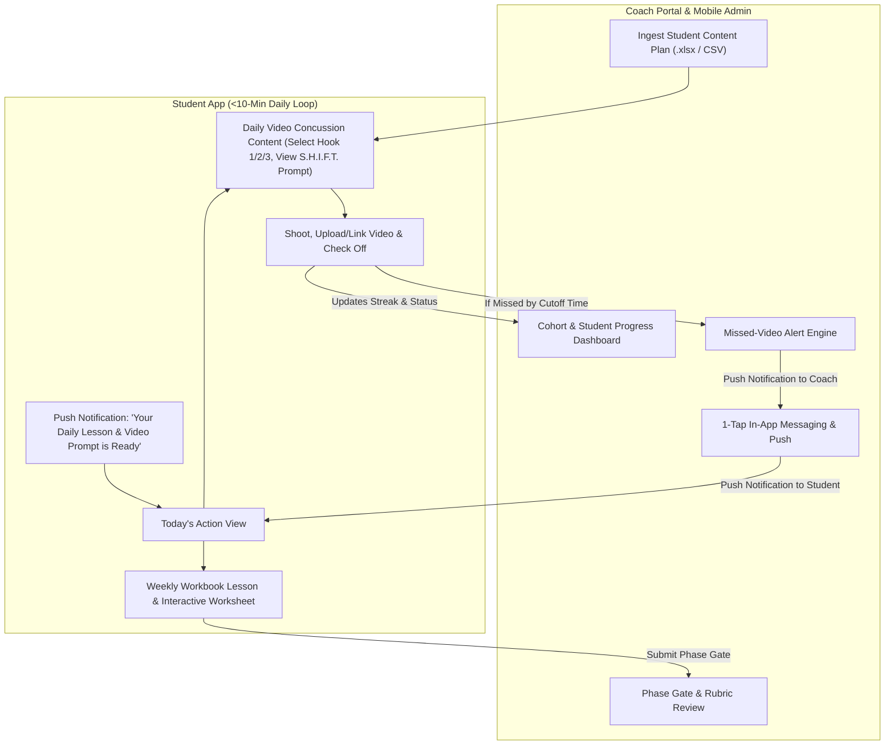
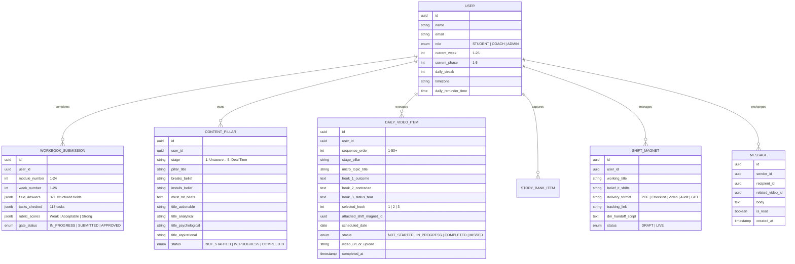

# Product Requirements Document (PRD): Market Concussion Coaching App

**Document Version:** 1.0  
**Source References:**  
- [Market Concussion Workbook.pdf](file:///Users/joshbeechraft/Market%20Concussion%20Coaching%20App/Market%20Concussion%20Workbook.pdf) (`CAM-005 · REV. A — Build The Machine`)  
- [josh_content_tracking-v2 (1).xlsx](file:///Users/joshbeechraft/Market%20Concussion%20Coaching%20App/josh_content_tracking-v2%20(1).xlsx) (`Content Playbook` & `Supporting Content` Concussion Content)  

---

## 1. Executive Summary & Vision

The **Market Concussion Coaching App** is a centralized, mobile-first web and native/PWA coaching platform built for operators in the **Market Concussion Coaching Program ("Build The Machine")**. 

The program installs a compounding customer acquisition system centered around the **7-11-4 benchmark** (accumulating 7 hours of consumed content, 11 touchpoints, across 4 locations) using a 25-video library, $5–10/day sequenced ads, daily short-form videos, Shift Magnets (lead magnets), a VSL, and a monthly conversion workshop.

### Core Objectives
1. **Interactive Digital Workbook & Curriculum:** Break down the 26-week *Market Concussion Workbook* (118 tasks, 371 worksheet fields across 24 modules and 5 phases) into digestible, gate-paced lessons and interactive digital worksheets—eliminating static PDFs.
2. **<10-Minute Daily Video Execution ("Concussion Content"):** Ingest each student's bespoke Content Plan spreadsheet (`Content Playbook` + `Supporting Content` 50-item Concussion Content) and present a frictionless daily action view where students pick a hook/angle, review shooting guidance, record/upload or link their daily video, and check off their daily cadence in under 10 minutes.
3. **Proactive Accountability & Coach Command Center:** Give the Coach a real-time dashboard to monitor every student's daily video streak, phase gate progress, and lead magnets, coupled with automated missed-day alerts and 1-tap in-app messaging with push notifications.

---

## 2. User Roles & Personas

| Role | Description | Core Needs |
| :--- | :--- | :--- |
| **Student (Operator)** | B2B consultant, agency owner, or high-ticket operator going through the coaching program. Often busy; prone to production friction. | Needs zero guesswork each morning: *"What is my lesson/task today, what video am I shooting today, what hook should I use, and how do I mark it done in <10 minutes?"* |
| **Coach / Admin (Josh & Team)** | Program creator and coaching staff managing cohorts and individual operators. | Needs bird's-eye visibility into who is on cadence vs. slipping, instant mobile notifications when a student misses a daily video, 1-tap in-app follow-up messaging, and access to review/approve phase gates and student assets. |

---

## 3. Core System Architecture & User Flows

---

## 4. Detailed Functional Requirements

### 4.1 Feature Pillar 1: Student Content Plan Ingestion Engine
Each student has a custom strategy spreadsheet modeled after [josh_content_tracking-v2 (1).xlsx](file:///Users/joshbeechraft/Market%20Concussion%20Coaching%20App/josh_content_tracking-v2%20(1).xlsx). The app must ingest this file per student (via `.xlsx`/`.csv` upload or template generation) and populate two interconnected tracks:

#### A. Core Pillars / Teaching Matrix (`Content Playbook` Tab)
- **Structure:** 5 Funnel Stages (`1. Unaware`, `2. Problem Aware`, `3. Solution Aware`, `4. Your Solution Aware`, `5. Deal Time`), containing 15 Core Pillars (3 per stage).
- **Fields Ingested per Pillar:**
  - `Pillar (Core Theme)` & `Stage`
  - `Progress / Status` (`Not Started`, `In Progress`, `Filmed`, `Published`)
  - `Breaks (Old Belief)` & `Installs (New Belief)`
  - `Must-Hit Beats` (bulleted talking points)
  - **4 Teaching Angles (60 Video Title Options total):**
    1. *Actionable Progress (How-To)*
    2. *Analytical Progress (Data/Numbers)*
    3. *Anthropological / Psychological Progress (Psychology)*
    4. *Aspirational Progress (Story/Case Study)*
- **Core 5 Brand Videos Integration:** Maps alongside the 5 Core Brand Assets from the Workbook (`B1 Documentary`, `B2 Product/Service`, `B3 Proof & Case Study`, `B4 Ownership Experience`, `B5 Expert Demos`).

#### B. Daily Supporting Videos (`Supporting Content` 50-Item Concussion Content Tab)
- **Structure:** 50 micro-topics mapped across the 5 Funnel Stages (`Unaware`, `Problem Aware`, `Solution Aware`, `Your Solution`, `Deal Time`).
- **Fields Ingested per Daily Video Item:**
  - `Pillar / Stage` (e.g., *1. Unaware Stage (Content)*)
  - `Micro-Topic Title` (e.g., *"Why Posting More Content is a Wasted Reach Trap"*)
  - **3 Selectable Hook Options:**
    - `Hook 1 (Outcome / Reputation)`
    - `Hook 2 (Contrarian / Curiosity)`
    - `Hook 3 (Status / Fear)`
  - `Progress / Status` (`Not Started`, `In Progress`, `Completed`)

---

### 4.2 Feature Pillar 2: The "<10-Minute" Daily Video Cadence Experience
To keep students on a strict daily publishing rhythm without overwhelm, the **Student Home Screen ("Today's Cadence")** is engineered for speed:

1. **Daily Video Prompt Card:**
   - Surfaces today's assigned video from the student's **Concussion Content** (or allows swapping to another unfilmed topic/core video).
   - Displays the **ShiftCycle™ Day Theme** (from Workbook Module 14 / W19):
     - *Monday:* **SIGNAL** (Curiosity — Attract aligned people)
     - *Tuesday:* **TENSION** (Frustration — Agitate the real problem)
     - *Wednesday:* **PROOF** (Hope — Build certainty / story from bank)
     - *Thursday:* **PERSPECTIVE** (Conviction — Replace old worldview)
     - *Friday:* **PATH** (Momentum — Make action inevitable)
2. **Interactive Hook & Script Selector:**
   - Displays the **Micro-Topic Title** and lets the student tap to select **Hook 1 (Outcome)**, **Hook 2 (Contrarian)**, or **Hook 3 (Status/Fear)** (or edit custom text).
   - Pulls in associated `Breaks (Old Belief)`, `Installs (New Belief)`, `Must-Hit Beats`, and linked **Shift Magnet / CTA** so the student has talking points right on screen.
3. **Built-In "How to Shoot" Micro-Training & Teleprompter/Timer:**
   - Collapsible **5-Take S.H.I.F.T. Production Guide** (from Workbook Fig. 06, p. 27):
     - *Take 1 · Signal (0:00–0:15):* Tight & direct close-up, high energy.
     - *Take 2 · Humanize (0:15–0:30):* Pivot 30° or medium shot, conversational.
     - *Take 3 · Illuminate (0:30–1:45):* "Real talk" steady shot, empathetic & authoritative.
     - *Take 4 · Formulate (1:45–3:00):* Teaching angle (whiteboard/desk/steps).
     - *Take 5 · Transfer (3:00–3:10):* Urgent close-up, directive CTA.
   - Optional on-screen bullet teleprompter and countdown timer (20s / 90s / 3m modes).
4. **Social Proof Link Verification & Mark Done (No Video File Storage):**
   - Videos are published directly to social platforms (Instagram, TikTok, YouTube, LinkedIn, Facebook).
   - To prove the daily video is done, the student **must paste their published social post URL** before marking **"Verified & Posted"**.
   - Checking off triggers immediate visual celebration, increments their **Daily Streak**, updates their **Concussion Content Progress Bar (e.g., 14/50 Supporting Videos, 3/5 Core Videos)**, and logs the verified social link for the Coach to inspect.

---

### 4.3 Feature Pillar 3: Interactive 26-Week Workbook & Phase Gate Engine
Digitizes the entire [Market Concussion Workbook.pdf](file:///Users/joshbeechraft/Market%20Concussion%20Coaching%20App/Market%20Concussion%20Workbook.pdf) (`CAM-005`) into structured, interactive modules.

#### Curriculum Architecture (5 Phases, 26 Weeks, 24 Worksheet Modules)
> *"Pace on the gate, not the calendar. A week that takes three weeks is normal. Only the Done When line decides whether you advance."*

| Phase | Weeks | Focus | Key Interactive Worksheets & Deliverables |
| :--- | :--- | :--- | :--- |
| **Phase 01: Foundation** *(What You Say)* | W1–W4 | Messaging & 7-Hr Benchmark | **Mod 01:** Starting Audit (Minutes available, audience size, owner, 5-mo agreement) **Mod 02:** The 7 Messaging Questions Canvas (Q1 Transformation, Q2 Tension [Frustrated/Overwhelmed/Sick & Tired], Q3 Shift [Increase/Reduce/Improve/Simplify/Optimize], Q4 Belief, Q5 Story, Q6 Hook, Q7 Mechanism Stages 1–5) + Self-Scoring Rubric **Mod 03:** Secondary Production Inputs (Core Objection, Core Illusion, Core Proof) **[◆ PHASE GATE at W4]** |
| **Phase 02: Raw Material** *(What You Say It With)* | W5–W8 | Story Bank, Topic Matrix & S.H.I.F.T. | **Mod 04:** Story Bank Capture (20 candidates scored 1–5 on Tension / Proof / Ease) **Mod 05:** Full Story Record (x8 repeatable sheets: Situation, Tension, Turn, Result, Point + 20s/90s/3m versions + Clearance) **Mod 06:** 5x4 Topic Matrix (5 Topics × 4 Angles = 20 Titles, linked to Story #, Funnel role, CTA) **Mod 07 & 08:** S.H.I.F.T. Script Sheet (x25 repeatable sheets) **[◆ PHASE GATE at W8]** |
| **Phase 03: Production** *(Building The Library)* | W9–W18 | 5 Core Brand Videos, 20 Teaching Videos, VSL | **Mod 09:** Production Setup & 10 Booked Filming Dates **Mod 10, 11, 12:** Repeatable Shoot Brief, 14-point Editing QA Checklist, Publishing QA Sheet **Mod 13A & 13B:** Documentary & Proof Video Quality Rubrics (W10 Documentary, W11 Product, W12 Proof, W13 Ownership, W14–17 Expert Batches 1–4) **Mod 18:** 13-Dimension VSL Builder + Rubric **[◆ PHASE GATE at W18]** |
| **Phase 04: Distribution** *(Getting It In Front of People)* | W19–W22 | ShiftCycle, $5–10 Ads, Shift Magnets, DMs | **Mod 14:** ShiftCycle Weekly Planner (Mon Signal → Fri Path) **Mod 15:** Paid Ad Sequence & Audience Map ($5–10/day, 25% watch gate → Full List) **Mod 16:** Shift Magnet Builder (Lead Magnet manager) **Mod 17:** DM Playbook (S.H.I.F.T. DM Matrix, 4-Level Re-engagement Loop, Per-Convo CRM Tracker) **Mod 21 & 22:** Metric Dictionary & Monthly Attention Dashboard **[◆ PHASE GATE at W22]** |
| **Phase 05: Conversion** *(Turning Attention Into Clients)* | W23–W26 | Monthly Event, Offer Doc & Quarterly Loop | **Mod 19:** Monthly Workshop Designer (Surface Struggle → Transfer Transformation) **Mod 20:** 1-Page Offer Document Builder + Rubric **Mod 23:** Event Debrief (within 48h) **Mod 24:** Quarterly Review & Coach Sign-Off |

#### Key Workbook UX Features:
- **Global Progress Counters:** Tracks exact completion against the workbook's **118 Tasks** and **371 Worksheet Fields**, plus **Accumulated Brand Minutes (Goal: 7 Hours / 420 Minutes)**.
- **Toggleable Worked Examples & Reference Figures:** Every worksheet includes a 1-tap toggle to view the *"Keystone Basement Systems"* worked example and system diagrams (`FIG. 00` through `FIG. 28`) without cluttering input fields.
- **Cross-Module Auto-Population ("Write Once, Reuse Everywhere"):**
  - Answers entered in **Mod 02 (7 Messaging Questions)**, **Mod 05 (Story Bank)**, and **Mod 16 (Shift Magnets)** automatically appear as selectable dropdowns/reference chips inside **Mod 06 (Topic Matrix)**, **Mod 08 (S.H.I.F.T. Script Sheets)**, **Mod 18 (VSL Builder)**, and the **Daily Video Concussion Content**.
- **Phase Gate Enforcement & Rubrics:** At Weeks 4, 8, 18, and 22, students grade their deliverable against the built-in *Weak / Acceptable / Strong* rubric and submit for Coach approval to unlock the next phase.

---

### 4.4 Feature Pillar 4: Lead Magnet ("Shift Magnet") & Offer Centralization
As requested (*"keep this whole thing organized, centralized on point as we have the lead magnets entered into the mix"*):
- **Shift Magnet Repository:** Dedicated hub (backed by Module 16) where students and coaches manage all Shift Magnets / Micromagnets (e.g., PDF guides, 9-point audits, custom GPTs, classes).
- **Tracked Attributes per Lead Magnet:** Working Title, Version, Target Audience, Triggering Problem, Core Belief it Shifts, Delivery Format, Hosted URL / Tracking Link, Delivery Automation status, and DM Handoff Script.
- **Direct Wiring into Videos:** When shooting a Daily Video or Core Video, the student selects which Shift Magnet (1st CTA — low friction) or VSL/Offer Doc (2nd CTA — ready now) is attached to that video, automatically supplying the exact call-to-action script and comment trigger word.

---

### 4.5 Feature Pillar 5: Coach Dashboard, Alerts & In-App Messaging
Designed so the Coach can manage the entire cohort from their phone in minutes a day:

1. **Cohort Command Center (Coach Dashboard):**
   - **Traffic-Light Student Roster:**
     - 🟢 **On Cadence:** Posted today's video; active in current workbook week.
     - 🟡 **At Risk:** Has not posted today's video by afternoon warning threshold, or stalled on a workbook week for >10 days.
     - 🔴 **Missed Cadence:** Missed yesterday's (or multiple) daily videos; requires immediate follow-up.
   - **Per-Student Drilldown:** View the student's uploaded videos/links, Concussion Content progress (`X/50 Supporting`, `Y/5 Core`, `Z/20 Matrix`), workbook inputs, Shift Magnets, and Monthly Attention Metrics (Watch Time, Avg View Duration, 25% Gate Clearance, Full List Size, DM Conversations).
2. **Automated Notification & Alert Engine:**
   - **Student Daily Reminder:** Push notification + optional SMS/email at the student's configured morning time (e.g., 8:00 AM local): *"Your daily lesson & video hook ('Why Posting More Content is a Wasted Reach Trap') is ready. Takes <10 mins!"*
   - **Coach Missed-Video Alert:** If a student has not checked off their daily video by their cutoff time (e.g., 5:00 PM), the Coach receives a push notification on their phone: *"⚠️ [Student Name] missed their daily video today (Streak at risk). Tap to message."*
3. **1-Tap In-App Messaging & Follow-Up:**
   - Tapping the missed-video notification opens a direct in-app chat thread with that student, pre-loaded with customizable quick-send coach templates:
     - *"Hey [Name], looks like we missed our video today — need any help with the hook or setup?"*
     - *"Loved your video today! Great energy on the Signal hook."*
   - Sending a message triggers an immediate **Push Notification** on the student's phone that deep-links straight into the in-app chat and today's video card.

---

## 5. Data Model Overview

---

## 6. Recommended Technical Stack

- **Frontend / Mobile Experience:** **Next.js (App Router) + TypeScript + Tailwind CSS** configured as an installable **Progressive Web App (PWA)** with Web Push Notifications (or React Native / Expo if App Store native binary is preferred), featuring the dark industrial blueprint aesthetic of `Market Concussion Workbook.pdf`.
- **Backend & Database:** **Supabase (PostgreSQL + Auth + Realtime + Storage)** or **Firebase (Auth + Firestore + Cloud Storage + Cloud Messaging)** for real-time chat, video uploads, and push notifications.
- **Spreadsheet Ingestion:** `SheetJS (xlsx)` parser to validate and import student `.xlsx` content plans in one click.
- **Scheduled Jobs / Cron:** Automated daily cron jobs (timezone-aware) for morning student lesson/video reminders and evening coach missed-cadence alerts.

---

## 7. Phased Rollout Plan (MVP to V2)

1. **Phase 1 (Core MVP):**
   - Student `.xlsx` Content Plan Importer (`Content Playbook` + `Supporting Content` 50-item Concussion Content).
   - Student "<10-Minute Daily Video" view (Hook selector, S.H.I.F.T. shooting guide, video upload/link, completion check-off & streak tracker).
   - Interactive Workbook & Worksheets (Phases 1–5, starting with Phase 1–2 foundational modules + global progress tracking).
   - Shift Magnet repository & CTA linker.
   - Coach Dashboard (student roster, completion tracking, missed-video alerts, and in-app chat with push notifications).
2. **Phase 2 (V1.1 Enhancements):**
   - Built-in mobile camera teleprompter with S.H.I.F.T. stage timing overlays.
   - Automated AI Hook & Script Refiner (using the student's Module 02 7 Messaging Questions to auto-draft custom hooks).
   - Ad Sequence & Monthly Attention Metrics live dashboard integration.
